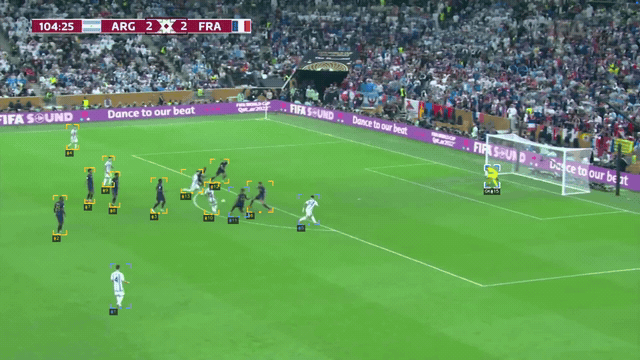
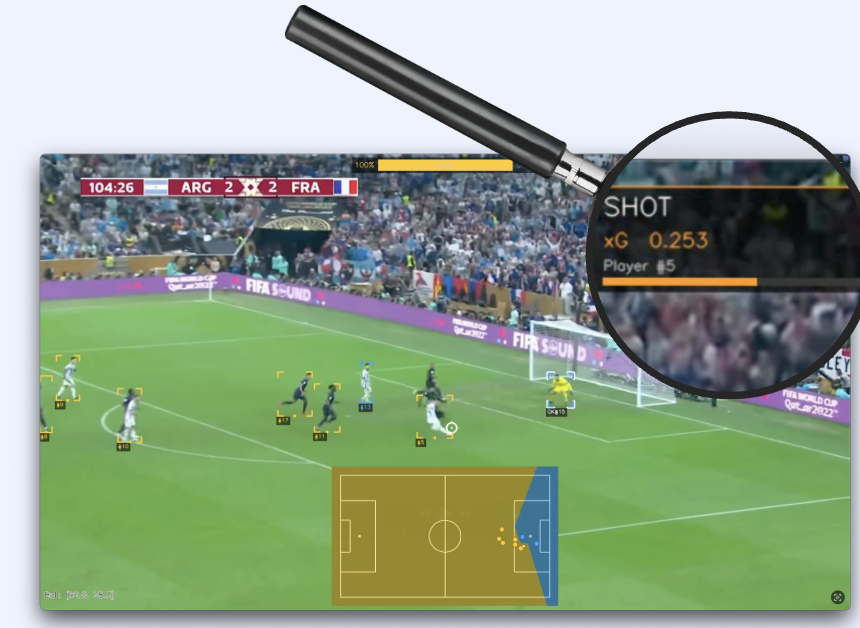
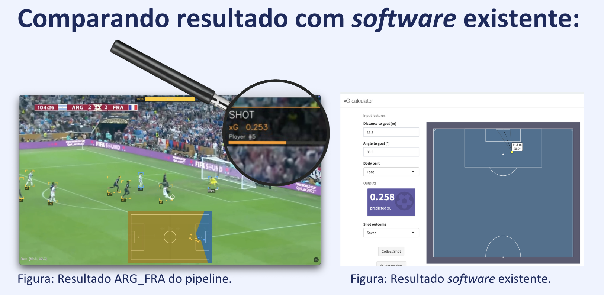
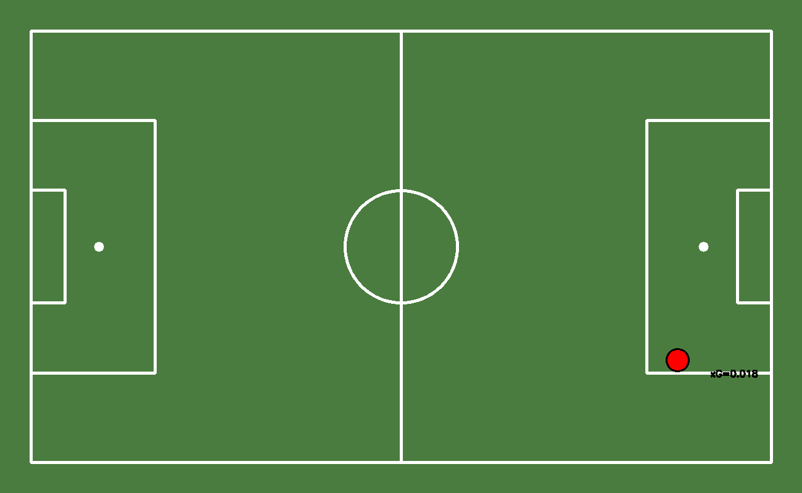

# VarzeaVision

Análise tática de futebol a partir de vídeos de transmissão, com detecção e rastreamento de jogadores e bola, calibração de campo, reconhecimento de finalizações e estimativa de Expected Goals (xG).

Projeto do Trabalho de Conclusão de Curso de **Eduardo Larson**, orientado pelo **Prof. Dr. Daniel Rigoni**, no Bacharelado em Ciência da Computação da **UNICENTRO**, em 2026.

## Demonstração em vídeo

[](docs/videos/demo-arg-fra.mp4)

[Abrir o vídeo completo em MP4](docs/videos/demo-arg-fra.mp4) · aproximadamente 7 segundos, em Full HD.

A prévia animada mostra o processamento do clipe ARG–FRA. O MP4 preserva a resolução original e foi convertido para H.264 para facilitar a reprodução no navegador.

## Exemplos de resultado



Resultado do pipeline em ARG–FRA, com destaque para a finalização e o xG estimado de 0,253.



Exemplo qualitativo: xG de 0,253 no pipeline e 0,258 na calculadora apresentada na defesa. Essa comparação de uma jogada não substitui a avaliação quantitativa do modelo.

As imagens de transmissão e da ferramenta externa pertencem aos respectivos titulares.

## O que o projeto implementa

- Detecção de jogadores, goleiros, árbitros e bola com YOLOv8, incluindo detector especializado de bola.
- Rastreamento de jogadores com BoT-SORT e da bola com Kalman, gate de Mahalanobis e optical flow.
- Classificação de times por aparência dos uniformes.
- Calibração do campo com PnLCalib e transformação para coordenadas métricas por homografia.
- Identificação de finalizações por proximidade, velocidade e direção da bola.
- XGNet em PyTorch para estimar a probabilidade de gol a partir de seis atributos espaciais e contextuais.
- Vídeo anotado, minimapa tático, mapas de finalizações, mapas de calor e estimativas de posse.

O módulo experimental de refinamento da bola com U-Net está no código, mas não integra o pipeline final avaliado no trabalho.

## Resultados reportados no TCC

Os números abaixo são os resultados históricos descritos no trabalho e na defesa; não foram recalculados nesta publicação. A avaliação de xG usa eventos estruturados do StatsBomb e é distinta da avaliação do pipeline completo em vídeo.

### Modelo de xG

Base de **60.148 finalizações**, abrangendo **26 combinações de competição e temporada**, com separação por partida via `GroupShuffleSplit`. O trabalho informa aproximadamente 12.030 finalizações no conjunto reservado.

| Modelo | AUC-ROC | Brier Score | xG médio |
| --- | ---: | ---: | ---: |
| XGBoost | 0,7903 | 0,0848 | 0,1124 |
| XGNet | 0,8096 | 0,0800 | 0,1111 |

**Ressalva de avaliação:** a implementação de XGNet ajusta o Platt Scaling nos logits e rótulos do mesmo conjunto em que calcula as métricas finais. Portanto, esse conjunto participa do ajuste do calibrador e não representa um teste totalmente independente. A próxima avaliação deve separar treino, calibração e teste por partida. AUC não deve ser interpretada como percentual de acerto de todas as previsões.

### Detecção de bola

| Modelo | Precisão | Recall | mAP50 |
| --- | ---: | ---: | ---: |
| YOLOv8x geral | 0,940 | 0,404 | 0,507 |
| YOLOv8x especializado | 0,696 | 0,655 | 0,631 |

O recall passou de **40,4% para 65,5%**, um ganho de **25,1 pontos percentuais**, acompanhado de redução da precisão. O mAP50 passou de 0,507 para 0,631, um ganho de 0,124.

### Finalizações em vídeo

Estudo piloto com cinco conjuntos de 14 clipes cada: **70 clipes**, com **56 clipes positivos e 14 controles**. BEL-ITA foi usado no desenvolvimento; os outros conjuntos avaliam novos contextos.

| Conjunto | Papel | Precisão | Recall | F1 |
| --- | --- | ---: | ---: | ---: |
| BEL-ITA | Desenvolvimento | 0,857 | 0,545 | 0,667 |
| BEL-RUS | Generalização | 1,000 | 0,364 | 0,533 |
| ARG-FRA | Generalização | 1,000 | 0,364 | 0,533 |
| FLA-CAP | Generalização | 0,667 | 0,182 | 0,286 |
| SAN-MIR | Generalização | 1,000 | 0,167 | 0,286 |

O tamanho reduzido da amostra limita as conclusões sobre generalização. O principal gargalo identificado é a detecção da bola, especialmente em transmissões diferentes do domínio de treinamento.



## Código e documentos

```text
src/
  main.py                 Pipeline e roteiro de avaliação usado na pesquisa
  configs/config.yaml     Caminhos dos modelos e parâmetros
  modules/                Detecção, rastreamento, homografia, times e xG
  tools/train_xg.py        Treinamento do modelo de xG
scripts/
  process_video.py         Entrada parametrizada para processar um clipe
docs/
  reproducibilidade.md    Dependências externas, pesos e limitações
  resultados.md           Protocolo e leitura dos resultados
  images/                 Exemplos extraídos dos materiais fornecidos
```

- [Texto completo do TCC em PDF](docs/TCC_Eduardo_Larson_Final_2026.pdf)
- [Apresentação da defesa em PowerPoint](docs/TCC-EduardoLarson.pptx)
- [Resultados e ressalvas metodológicas](docs/resultados.md)
- [Preparação e execução](docs/reproducibilidade.md)

## Execução

O código depende de pesos treinados e componentes externos que não estão incluídos. Prepare os arquivos descritos no [guia de reprodução](docs/reproducibilidade.md) antes de executar.

```bash
git clone https://github.com/edularson/TCC-EduardoLarson.git
cd TCC-EduardoLarson
python3 -m venv .venv
source .venv/bin/activate
python -m pip install -r requirements.txt
```

No Windows, ative o ambiente com `.venv\Scripts\activate`. Com os componentes externos, os pesos e o modelo de xG preparados:

```bash
python scripts/process_video.py --video caminho/partida.mp4 --output outputs/partida.mp4
```

Esse comando não executa treinamento de xG nem calcula métricas de avaliação de finalizações. O classificador de uniformes é ajustado ao clipe fornecido a cada execução.

## Limitações e próximos passos

- Separar calibração e teste do XGNet e recalcular as métricas.
- Ampliar a avaliação em vídeo e os dados de futebol brasileiro.
- Disponibilizar os pesos próprios e registrar as versões dos componentes externos.
- Validar a instalação completa em ambiente limpo.
- Melhorar o rastreamento sob oclusões e a consistência de identidade dos jogadores.
- Revisar o roteiro histórico em `src/main.py` antes de reutilizá-lo para avaliação: contém caminhos e anotações de um experimento específico.

## Créditos

Implementação e pesquisa: Eduardo Larson. Orientação: Prof. Dr. Daniel Rigoni. Dependências e dados: Ultralytics, Roboflow Sports, PnLCalib, SoccerNet e StatsBomb Open Data, com seus respectivos autores, licenças e condições de uso. Os componentes externos, pesos e conjuntos de vídeos de avaliação não estão incluídos. O clipe processado de demonstração foi fornecido pelo autor; as imagens da transmissão pertencem aos respectivos titulares.

[Perfil do autor](https://github.com/edularson) · [Contato](mailto:eduardolarson05@gmail.com)
