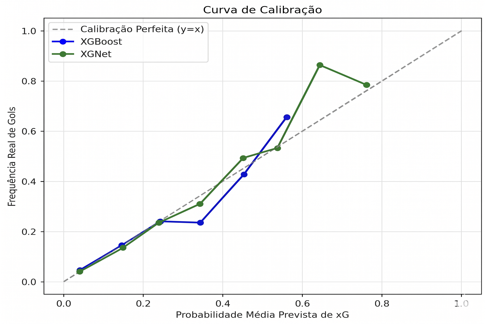

# Resultados e protocolo de avaliação

## Fontes

Os resultados são transcritos do [TCC final](TCC_Eduardo_Larson_Final_2026.pdf), seções 3.5, 3.6 e 4, e da [apresentação da defesa](TCC-EduardoLarson.pptx). A inspeção do código foi usada para registrar limitações de reprodução. Os documentos originais foram preservados.

## Estimativa de xG

O XGNet recebe distância ao gol, ângulo de finalização, indicadores de uso de pé e cabeça, distância ao defensor mais próximo e número de defensores no cone de visada. A rede usa camadas de 64, 32, 16 e 8 unidades, com ReLU, Batch Normalization e Dropout conforme a implementação.

A base total é de 60.148 eventos do StatsBomb, com divisão por partida. O resultado reportado para o XGNet é AUC-ROC 0,8096 e Brier Score 0,0800, comparado a 0,7903 e 0,0848 no XGBoost.

Na implementação fornecida, `platt.fit(test_logits.reshape(-1, 1), y_test)` ajusta a calibração nos mesmos exemplos usados para calcular o Brier Score e a AUC finais. A divisão por partida evita a mistura das mesmas partidas entre os dois grupos iniciais, mas não elimina a reutilização do conjunto final para calibração. Esses números precisam ser reavaliados com um terceiro grupo de partidas reservado exclusivamente ao teste.

A proximidade entre xG médio e taxa de gols, isoladamente, não demonstra calibração adequada em todas as faixas de probabilidade. O gráfico histórico abaixo deve ser interpretado junto dessa ressalva.

## Finalizações em vídeo

| Conjunto | Clipes | Positivos | Controles | TP | FP | FN | TN |
| --- | ---: | ---: | ---: | ---: | ---: | ---: | ---: |
| BEL-ITA | 14 | 11 | 3 | 6 | 1 | 5 | 2 |
| BEL-RUS | 14 | 11 | 3 | 4 | 0 | 7 | 3 |
| ARG-FRA | 14 | 11 | 3 | 4 | 0 | 7 | 3 |
| FLA-CAP | 14 | 11 | 3 | 2 | 1 | 9 | 2 |
| SAN-MIR | 14 | 12 | 2 | 2 | 0 | 10 | 2 |

São 70 clipes no total. BEL-ITA participa do desenvolvimento; os demais representam contextos adicionais. Não se deve tratar esses 70 clipes como um único teste independente do desenvolvimento. O critério de referência descrito no trabalho é a presença ou ausência de finalização no clipe, não uma avaliação completa de localização temporal de eventos em partidas inteiras.

A precisão varia de 0,667 a 1,000 e o recall de 0,167 a 0,545. Os valores perfeitos de precisão resultam de poucos eventos e não demonstram ausência de falsos positivos em uso geral. O TCC apresenta intervalo bootstrap de 95% de [0,273; 0,818] para o recall de BEL-ITA, ilustrando a incerteza da amostra.

## Diferenças e cuidados com as fontes

- O slide de comparação dos detectores informa ganho de 24 pontos percentuais em mAP50, mas os valores exibidos, 0,507 e 0,631, correspondem a 12,4 pontos percentuais. O README usa os valores das tabelas do texto.
- O texto apresenta médias gerais diferentes para o detector de objetos na narrativa e na tabela. Por isso, o resumo utiliza apenas a comparação de bola que está explicitamente tabulada.
- O roteiro histórico de `src/main.py` usa outro conjunto, BRA-JAP, com rótulos e comentários que precisam de revisão. Ele não constitui reprodução automática das cinco avaliações tabuladas no TCC.
- O módulo U-Net teve avaliação isolada, mas não integra o pipeline final devido ao problema de mudança de domínio relatado no trabalho.

## Próxima avaliação

Separar partidas em treino, calibração e teste; manter teste intocado até a avaliação final; registrar sementes, versões, pesos e contagens exatas; publicar as anotações e o procedimento de avaliação quando sua redistribuição for permitida; ampliar a amostra de vídeo e avaliar a localização temporal dos eventos.
